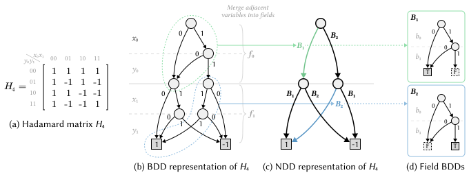

# NDD: Network Decision Diagram

[](https://github.com/XJTU-NetVerify/NDD/actions/workflows/ci.yml)
[](LICENSE)

## About

**Network Decision Diagram (NDD)** is a new decision diagram, built on the classical [Binary Decision Diagram (BDD)](https://en.wikipedia.org/wiki/Binary_decision_diagram).
For BDD, each node looks at a single **bit** each time, and branches based on whether the bit is true or false;
in contrast, each NDD node looks at a **field** consisting of a fixed number of bits each time, and branches based on what set of values the field takes.
But different from the classical multi-valued decision diagram (MDD), where a branch takes one **concrete** value from a domain, each branch in NDD takes a **symbolic** value, i.e., a subset of values from a domain.

The branching conditions are compactly encoded with interchangeable label representations,
including BDD, [complemented-edge BDD (BCDD)](https://dl.acm.org/doi/10.1145/123186.123222),
[zero-suppressed decision diagrams (ZDD)](https://en.wikipedia.org/wiki/Zero-suppressed_decision_diagram),
and explicit BITSET truth tables for small domains.
In this sense, NDD can be seen as wrapping a lower-level decision diagram with an outer field-aware layer, and therefore the name of NDD can also be interpreted as "Nested Decision Diagram".

**An example of NDD** In the figure below, we represent Hadamard matrix _H_<sub>4</sub>'s values on each coordinate (_x_<sub>0</sub>_x_<sub>1</sub>, _y_<sub>0</sub>_y_<sub>1</sub>) as a BDD (in (b)) and an NDD (in (c)). Each NDD node represents a 2-bit field (_f_<sub>1</sub> and _f_<sub>2</sub>), and the branching condition is encoded with 2 BDDs (in (d)).



NDD was originally proposed for network verification, where each NDD node represents a packet header field (e.g., destination IP address).
We observed that NDD was more efficient than BDD in terms of memory and computation.
The reason is that, due to the **locality** of field-based matching semantics, NDD can significantly reduce the number of nodes.

## Features

- **Far fewer nodes than BDD**: by branching on whole fields and sharing label decision diagrams across fields, NDD can use far fewer nodes than BDD for field-structured problems, such as network verification, due to field locality. This reduces both memory use and computation time (see the [NSDI paper](https://www.usenix.org/system/files/nsdi25-li-zechun.pdf) and the [network verification results](https://github.com/XJTU-NetVerify/NDD/wiki/Results-SRE)).
- **Multiple label backends**: edge labels can be encoded as BDD, complemented-edge BDD (BCDD), ZDD, or BITSET (for fields of at most 7 bits). Backends can be mixed, with each field using its own backend (see [Design Notes](https://github.com/XJTU-NetVerify/NDD/wiki/Design-Notes)).
- **Multiple terminals**: Multi-Terminal NDD (MTNDD) allows terminals to hold numeric values (integer, rational, or floating point) instead of only `true`/`false`, with arithmetic operations (`plus`, `minus`, `times`, `divide`) and sum abstraction. Useful for weights, costs, link loads, probabilities, and integer matrices. Available on the [`mtndd`](https://github.com/XJTU-NetVerify/NDD/tree/mtndd) branch.
- **Parallelism**: a C11 core with a JNI-based Java API runs NDD operations on multiple worker threads, reaching about 3.5× speedup with 6 workers on N-Queens. Available on the [`parallel`](https://github.com/XJTU-NetVerify/NDD/tree/parallel) branch (Boolean NDD) and the [`parallel-MTNDD`](https://github.com/XJTU-NetVerify/NDD/tree/parallel-MTNDD) branch (multi-terminal NDD); the native build is currently documented for Linux.

## Quick Start

**Prerequisites**: JDK 11 or later, Maven 3, and Git.

1. Clone and build the library. This produces `target/ndd-1.0.1-jar-with-dependencies.jar`, which bundles NDD with all its dependencies.

   ```bash
   git clone https://github.com/XJTU-NetVerify/NDD.git
   cd NDD
   mvn -DskipTests package
   ```

   To use NDD from your own Maven project instead, run `mvn -DskipTests install` and add this dependency:

   ```xml
   <dependency>
       <groupId>org.ants</groupId>
       <artifactId>ndd</artifactId>
       <version>1.0.1</version>
   </dependency>
   ```

2. Save the following as `QuickStart.java`. It builds the Hadamard matrix example from the figure above
   as both a BDD and an NDD, and compares their sizes:

   ```java
   import java.util.HashSet;
   import java.util.Set;

   import jdd.bdd.BDD;
   import org.ants.jndd.diagram.NDD;

   public class QuickStart {
       public static void main(String[] args) {
           // Hadamard matrix H_{2^n}: entry (x, y) is -1 iff x0·y0 XOR x1·y1 XOR ... = 1.
           // n = 2 gives H4 from the figure.
           int n = 2;

           // BDD: one variable per bit, ordered x0, y0, x1, y1, ... as in (b).
           BDD bdd = new BDD(10_000, 1_000);
           int h = bdd.getZero();
           for (int i = 0; i < n; i++) {
               int xi = bdd.createVar();
               int yi = bdd.createVar();
               h = bdd.xor(h, bdd.and(xi, yi));
           }

           // NDD: one 2-bit field (xi, yi) per i, as in (c).
           NDD.initNDD(10_000, 1_000, 10_000, 1_000);
           for (int i = 0; i < n; i++) {
               NDD.declareField(2);
           }
           NDD.generateFields();
           int ndd = NDD.getFalse();
           for (int i = 0; i < n; i++) {
               int xiAndYi = NDD.and(NDD.getVar(i, 0), NDD.getVar(i, 1));
               ndd = NDD.apply(NDD.BinaryOperation.XOR, ndd, xiAndYi);
           }

           System.out.println("BDD nodes: " + bdd.nodeCount(h));                 // 6 (= 4n - 2)
           System.out.println("NDD nodes: " + nodeCount(ndd, new HashSet<>()));  // 3 (= 2n - 1)
       }

       // Count the distinct non-terminal nodes reachable from an NDD root.
       static int nodeCount(int node, Set<Integer> seen) {
           if (NDD.isTerminal(node) || !seen.add(node)) return 0;
           int count = 1;
           for (int i = 0; i < NDD.getEdgeCount(node); i++) {
               count += nodeCount(NDD.getEdgeTarget(node, i), seen);
           }
           return count;
       }
   }
   ```

   The NDD needs half as many nodes as the BDD, and the gap grows with `n`. Its edge labels add only
   two small BDDs, `xi ∧ yi` and `¬(xi ∧ yi)` as in (d), because all fields share the same label
   variables and therefore the same label BDDs.

   NDD calls must follow this order: `initNDD(...)`, then `declareField(...)` for every field, then `generateFields()`, and only then logical operations.
   For brevity, this example skips `ref()`/`deref()`; larger programs should protect the nodes they keep (see [APIs](#apis)).

3. Compile and run it against the jar:

   ```bash
   javac -cp target/ndd-1.0.1-jar-with-dependencies.jar QuickStart.java
   java -cp target/ndd-1.0.1-jar-with-dependencies.jar:. QuickStart
   ```

   On Windows, the classpath separator is `;`. In cmd or PowerShell, use `-cp target/ndd-1.0.1-jar-with-dependencies.jar;.`;
   in Git Bash, quote it: `-cp "target/ndd-1.0.1-jar-with-dependencies.jar;."`.

To try a larger workload, run the N-Queens benchmark ([`NDDSolution.java`](src/main/java/application/nqueen/NDDSolution.java)) for one or more board sizes:

```bash
java -cp target/ndd-1.0.1-jar-with-dependencies.jar application.nqueen.NDDSolution 8 9 10
```

It prints one `NQUEENS_METRICS` line per board size, with the number of solutions (e.g., 92 for N=8), node counts, and the running time.
Add `--bcdd` or `--zdd` before the sizes to switch the label backend.

## Benchmark

The following table shows the benchmark for **N-Queens** with N=12 and N=13.

| Implementation | Language | N=12 time (s) | N=13 time (s) |
| --- | --- | ---: | ---: |
| BuDDy | C | 53.601 | >500 |
| CUDD | C | 31.968 | 224.422 |
| JDD | Java | 26.878 | 219.003 |
| JavaBDD-C | Java/C | 24.439 | 230.309 |
| JavaBDD | Java | 27.867 | 293.619 |
| DD-BDD | C# | 15.511 | 105.936 |
| DD-CBDD | C# | 13.055 | 83.637 |
| **NDD** | **Java** | **3.823** | **27.172** |

For more details, please refer to [N-Queens Benchmark](https://github.com/XJTU-NetVerify/NDD/wiki/Results-NQueens).

## APIs

All APIs are static methods of `org.ants.jndd.diagram.NDD`, and an NDD is referred to by its integer node id.

- **Logical operations**: `and()`, `or()`, `not()`, `diff()`, `imp()`, or `apply(op, a, b)` with any `BinaryOperation` (`AND`, `OR`, `XOR`, `NAND`, `NOR`, `BIIMP`, `IMP`, `DIFF`).
- `simplify(f, careSet)`: generalized cofactor; returns a smaller NDD that agrees with `f` wherever `careSet` holds.
- `restrict(a, field, value)`: fix a field to a concrete value and obtain its cofactor, with the field removed.
- `exist(a, fields...)`: existential quantification over one or more fields.
- `substitute(a, source, target)`: rename field `source` to `target` (the two fields must have the same width).
- **Satisfying assignments**: `satCount(a)` counts them; `anySat(a)` returns one (one 0/1 entry per bit of each field), or `null` if `a` is false; `allSat(a, consumer)` enumerates all of them, and the consumer may return `false` to stop early.
- **Memory management**: `ref()`/`deref()` protect and release nodes, and `gc()` reclaims unreferenced nodes.

Refer to the [API guide](https://github.com/XJTU-NetVerify/NDD/wiki/Manipulation-APIs) for more details.

## Branches

- [`main`](https://github.com/XJTU-NetVerify/NDD/tree/main): The current library, with an efficient node table and multiple label backends.
- [`mtndd`](https://github.com/XJTU-NetVerify/NDD/tree/mtndd): Multi-Terminal NDD (MTNDD), whose terminals hold numeric values, with arithmetic operations.
- [`parallel`](https://github.com/XJTU-NetVerify/NDD/tree/parallel): Parallel Boolean NDD with a C11 core and a JNI-based Java API.
- [`parallel-MTNDD`](https://github.com/XJTU-NetVerify/NDD/tree/parallel-MTNDD): Parallel MTNDD, combining multiple terminals with the parallel C11 core.
- [`reuse`](https://github.com/XJTU-NetVerify/NDD/tree/reuse): Reuse of label decision-diagram variables among all fields.
- [`ndd-original`](https://github.com/XJTU-NetVerify/NDD/tree/ndd-original): The original prototype for the NSDI '25 paper.

## Ongoing Work

The current NDD library is by far not the end. Multiple terminals and parallel computation are now available on separate branches (see [Branches](#branches)), and we are working on (1) moving MTNDD into a separate repository as a standalone library, and (2) using NDD for more applications like model checking.

## Resources

- [wiki](https://github.com/XJTU-NetVerify/NDD/wiki)
- [NSDI Paper](https://www.usenix.org/system/files/nsdi25-li-zechun.pdf)
- [NSDI talk slides](https://xjtu-netverify.github.io/papers/NDD/NDD-A-Decision-Diagram-for-Network-Verification.pdf)
- [NSDI talk video](https://www.youtube.com/watch?v=9Ni6Z7qKGV4)

## Citation

```bibtex
@inproceedings{NDD,
  title={NDD: A Decision Diagram for Network Verification},
  author={Li, Zechun and Zhang, Peng and Zhang, Yichi and Yang, Hongkun},
  booktitle={22nd USENIX Symposium on Networked Systems Design and Implementation (NSDI 25)},
  pages={237--258},
  year={2025}
}
```

## Contact

- Peng Zhang (p-zhang@xjtu.edu.cn)
- Yichi Zhang (augists@outlook.com)
- Zechun Li (1467874668@qq.com)

## License

Apache-2.0. See [`LICENSE`](LICENSE).
