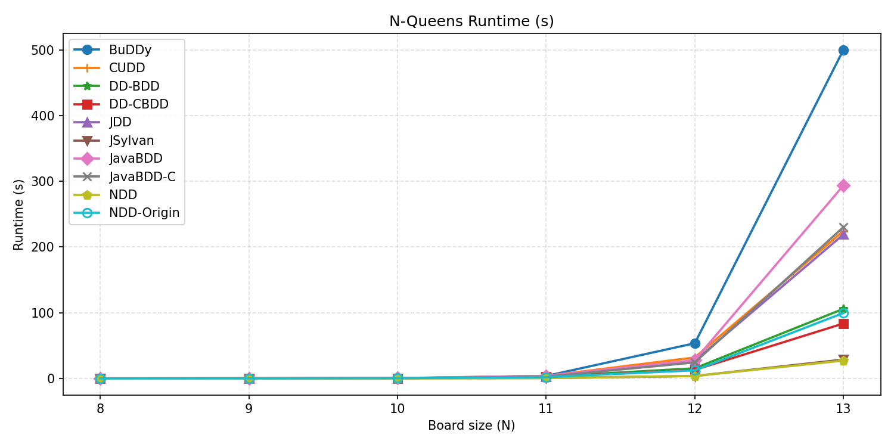
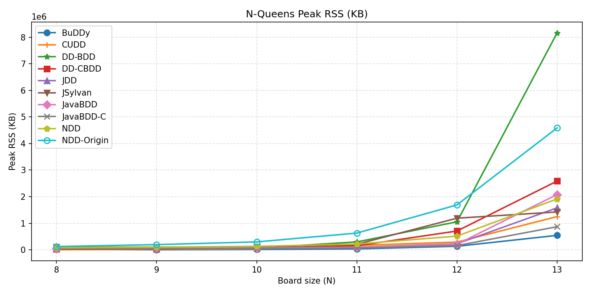
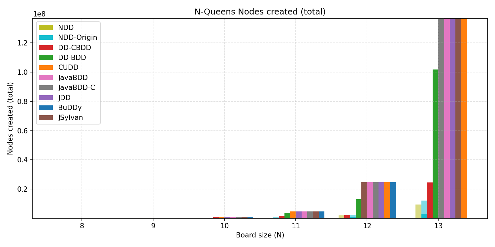
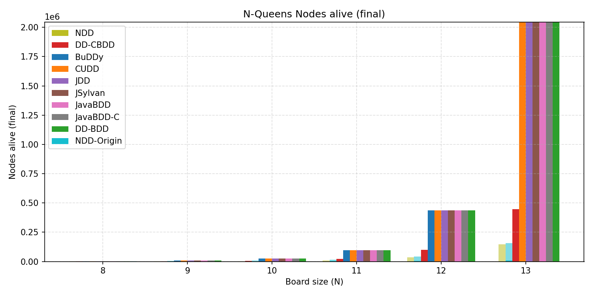

# Results: NQueens

> The `ndd-zdd` rows on this page are archived results from the removed finite-domain ZDD backend.
> That backend used a one-of-`w` domain and is not the current set-family `ZDD` implementation,
> whose width-`w` domain contains `2^w` Boolean bit vectors. New backend comparisons must rerun the
> benchmark; the legacy rows below are retained only as experiment history.

This page preserves the detailed NQueens benchmark table from [`results/nqueens_metrics.csv`](../results/nqueens_metrics.csv).

For the dedicated NQueens benchmarking repository, including the broader cross-library harness and related implementations, see <https://github.com/XJTU-NetVerify/nqueensBenchmarkDDs>.

NQueens is the easiest benchmark in this repository to understand and rerun, so it is also the clearest place to see what the current `NDD` implementation changes in practice.

## What This Page Shows

- cross-library comparisons across C, Java, and C# implementations
- the gap between `NDD-Origin` and the current `NDD` implementation
- not just runtime, but also memory footprint and node counts
- a snapshot of the NQueens evaluation that complements the standalone benchmark repository

## Main Takeaways

- `NDD` preserves the same solution counts as the other exact DD implementations.
- The biggest gains over the `NDD-Origin` baseline show up from size `10` onward.
- The reduced BDD-node counts of `NDD` show the effect of the variable-reuse optimization together with the current array-based execution.
- The archived backend comparison exercised an older finite-domain ZDD experiment. Its relative
  timings do not characterize the current `ZDD` backend.

## Highlight Table

| Size | NDD-Origin time (s) | NDD time (s) | Speedup | NDD-Origin RSS (KB) | NDD RSS (KB) | RSS reduction |
| --- | ---: | ---: | ---: | ---: | ---: | ---: |
| 8 | 0.082 | 0.040 | 2.04x | 122684 | 77304 | 37.0% |
| 9 | 0.188 | 0.067 | 2.80x | 194568 | 99060 | 49.1% |
| 10 | 0.548 | 0.156 | 3.52x | 297076 | 130416 | 56.1% |
| 11 | 2.039 | 0.565 | 3.61x | 628428 | 216192 | 65.6% |
| 12 | 12.419 | 3.823 | 3.25x | 1689668 | 514104 | 69.6% |
| 13 | 99.588 | 27.172 | 3.67x | 4587560 | 1913028 | 58.3% |

## Label Backend Comparison

These results compare plain decision diagram baselines and NDD using different edge-label backends.

Targets:

- `bdd`: plain BDD baseline
- `zdd`: plain ZDD baseline
- `bcdd`: plain complemented-edge BDD baseline
- `ndd`: NDD with standard BDD edge labels
- `ndd-zdd`: retired finite-domain ZDD edge labels (legacy rows only)
- `ndd-bcdd`: NDD with complemented-edge BDD edge labels

### N = 8

| target | solutions | time (s) | memory (MB) | nodes created | nodes alive |
| --- | ---: | ---: | ---: | ---: | ---: |
| bdd | 92 | 0.0330 | 58.9 | 52,474 | 2,451 |
| zdd | 92 | 0.0125 | 50.2 | 21,107 | 373 |
| bcdd | 92 | 0.0878 | 83.2 | 52,412 | 2,450 |
| ndd | 92 | 0.0377 | 61.3 | 10,797 | 600 |
| ndd-zdd | 92 | 0.0342 | 64.9 | 9,067 | 451 |
| ndd-bcdd | 92 | 0.0363 | 60.8 | 10,823 | 1,312 |

### N = 9

| target | solutions | time (s) | memory (MB) | nodes created | nodes alive |
| --- | ---: | ---: | ---: | ---: | ---: |
| bdd | 352 | 0.1009 | 62.4 | 216,443 | 9,557 |
| zdd | 352 | 0.0483 | 61.3 | 81,984 | 1,309 |
| bcdd | 352 | 0.3326 | 210.6 | 216,215 | 9,556 |
| ndd | 352 | 0.0696 | 71.4 | 29,451 | 1,364 |
| ndd-zdd | 352 | 0.0632 | 65.8 | 26,578 | 1,178 |
| ndd-bcdd | 352 | 0.0699 | 77.5 | 29,485 | 2,773 |

### N = 10

| target | solutions | time (s) | memory (MB) | nodes created | nodes alive |
| --- | ---: | ---: | ---: | ---: | ---: |
| bdd | 724 | 0.3264 | 68.5 | 955,575 | 25,945 |
| zdd | 724 | 0.1636 | 68.2 | 343,536 | 3,120 |
| bcdd | 724 | 1.4544 | 690.3 | 953,944 | 25,944 |
| ndd | 724 | 0.1847 | 93.5 | 97,595 | 2,905 |
| ndd-zdd | 724 | 0.1651 | 97.5 | 92,654 | 2,680 |
| ndd-bcdd | 724 | 0.1847 | 101.7 | 97,638 | 5,675 |

### N = 11

| target | solutions | time (s) | memory (MB) | nodes created | nodes alive |
| --- | ---: | ---: | ---: | ---: | ---: |
| bdd | 2,680 | 2.3780 | 94.4 | 4,691,834 | 94,822 |
| zdd | 2,680 | 0.7121 | 80.9 | 1,552,727 | 10,503 |
| bcdd | 2,680 | 8.6851 | 3133.5 | 4,685,028 | 94,821 |
| ndd | 2,680 | 0.5399 | 196.3 | 398,650 | 8,579 |
| ndd-zdd | 2,680 | 0.5556 | 207.9 | 388,606 | 8,310 |
| ndd-bcdd | 2,680 | 0.6840 | 202.1 | 398,703 | 14,023 |

### N = 12

| target | solutions | time (s) | memory (MB) | nodes created | nodes alive |
| --- | ---: | ---: | ---: | ---: | ---: |
| bdd | 14,200 | 16.9083 | 218.2 | 24,717,257 | 435,170 |
| zdd | 14,200 | 5.2012 | 115.6 | 7,592,039 | 45,833 |
| bcdd | 14,200 | 20.4717 | 315.5 | 24,717,255 | 435,169 |
| ndd | 14,200 | 3.0199 | 567.2 | 1,859,828 | 33,638 |
| ndd-zdd | 14,200 | 2.8683 | 559.4 | 1,831,431 | 33,561 |
| ndd-bcdd | 14,200 | 3.0480 | 742.1 | 1,859,892 | 33,637 |

### N = 13

| target | solutions | time (s) | memory (MB) | nodes created | nodes alive |
| --- | ---: | ---: | ---: | ---: | ---: |
| bdd | 73,712 | 138.8387 | 2127.1 | 136,722,638 | 2,044,394 |
| zdd | 73,712 | 42.8324 | 212.6 | 39,087,758 | 204,781 |
| bcdd | 73,712 | 139.4397 | 2188.9 | 136,587,014 | 2,044,393 |
| ndd | 73,712 | 22.3243 | 2460.7 | 9,378,160 | 145,368 |
| ndd-zdd | 73,712 | 20.9622 | 2446.8 | 9,267,948 | 145,278 |
| ndd-bcdd | 73,712 | 22.3683 | 3212.9 | 9,378,236 | 145,367 |

## Full Results Table

The full results for every implementation and board size are in
[`results/nqueens_metrics.csv`](../results/nqueens_metrics.csv); its columns are described in
[`results/README.md`](../results/README.md).

> Note: `JSylvan` is a parallel BDD library and was run with 48 worker threads. All other
> implementations are single-threaded.

## Plots

### Time

### Memory

### Node Counts

