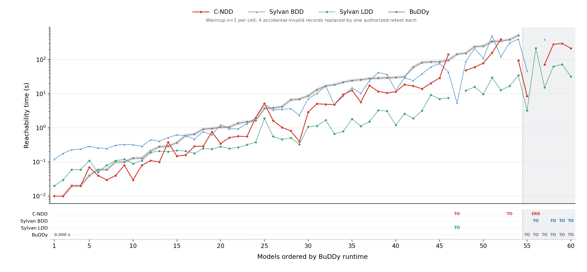

# Symbolic model-checking benchmark

## Task and implementation

NDD’s field-oriented representation naturally matches the state-vector structure used in symbolic model checking. A model state is a tuple of variables; an NDD field corresponds to a whole state variable, and its edge labels represent symbolic sets of possible values. Values that share a continuation can therefore be grouped in a label while sharing the remainder of the state diagram. Read/write projections and identity on unchanged variables similarly connect the structure of grouped transitions to field-level relation operations.

This benchmark explores that fit through **symbolic reachability**, adding a model-checking workload alongside network verification and combinatorial examples such as N-Queens. The original60 suite contains **60 DVE models from 56 named families**, including concurrency, mutual exclusion, communication protocols, control systems and puzzles. The categories describe the included model families rather than official dataset labels.

A model is represented by an initial state vector and grouped transition relations. The task is to compute the set of all states reachable from the initial state. LTSmin supplies the model frontend, dependency matrices, static regrouping and breadth-first exploration. The native C-NDD extension supplies symbolic state sets and relational image through LTSmin's vector-set interface.

At each step, the checker computes successors of the current frontier, removes already visited states and adds the remaining states to the visited set. It repeats until no new states remain. This evaluates forward symbolic reachability; it is not a benchmark of arbitrary temporal-logic properties or numeric-terminal operations.

The native implementation uses one NDD field per state slot. State sets and relations remain C-NDD objects, while BCDD labels encode field-local constraints. Read/write/copy modes preserve partially dependent transitions and cross-field correlations. See [implementation notes](../../doc/model-checking.md).

**Implementation identity:** these measurements exercise the Boolean MC extension of the native C11 core already supplied by the `parallel` branch, developed and evaluated on `codex/cndd-c1`. The public integration is selected with `--vset=cndd`. The underlying native runtime is task-capable, but every measurement uses one worker. No multi-terminal or multicore performance is claimed.

## Experimental settings

- Frontend: LTSmin master snapshot `07f9bf8aa8957cab4f8a47c1a943bf7fef968288`, declaring version 3.1.0-dev; this is a pinned development snapshot, not a 3.1.0 release or a claim about today's latest upstream revision.
- Inputs: 60 frozen DVE models; all backends use the same compiled plugin for each model. Model compilation is excluded from the timed checker process.
- Exploration: `--order=bfs-prev -rgs --when`. Backend positions rotate across models. Checker processes execute sequentially on CPU0.
- Runtime: one worker for C-NDD and both Sylvan backends; BuDDy is sequential. The container has a 16-CPU quota and 120 GiB memory, no swap. Per-process limits are 80 GiB address space and a 600-second timeout with five-second kill grace.
- Native dependencies: Sylvan `c8bf561ee64036375f4693eb389e57ec8ef4aa6d` and Lace `63d8a5ea79922a234e284ee4b264fa5e4e784939`. Reference backends retain the historical Sylvan 1.1.2/BuDDy 2.4 library identities and adapters ported to this frontend. HWLOC binding is constrained before discovery; actual checker threads are sampled on CPU0.

| Backend | Options, in addition to common exploration flags |
| --- | --- |
| C-NDD | `--vset=cndd --cndd-workers=1 --cndd-memory-mib=1024 --cndd-cache-log2=20 --cndd-gc-interval=0`; compile-time full-image pair cache enabled |
| BuDDy | `--vset=fdd --lace-workers=1 --fdd-reorder=none --fdd-bits=16 --cache-ratio=64 --max-increase=1000000 --min-free-nodes=20` |
| Sylvan BDD | `--vset=sylvan --lace-workers=1 --sylvan-sizes=24,30,23,30 --sylvan-bits=16 --sylvan-granularity=1` |
| Sylvan LDD | `--vset=lddmc --lace-workers=1 --sylvan-sizes=24,30,23,30` |

GC interval zero disables periodic MC admission-triggered collection, not capacity-triggered collection or Sylvan GC. The implementations retain different encodings, runtimes and allocation policies. Equal process limits do not imply equal internal memory budgets.

## Preliminary results



The metric is the reported `reachability took ... real` time, in seconds. It excludes separately reported initialization, final state counting and exit work. This is one retained warmup observation per model/backend, with four separately authorized replacement retests for invalid/interrupted observations. There are no repeated formal measurements. Original records remain archived; the figure is explicitly the supplemented snapshot.

All backends share BuDDy's model order: successful exploration times ascending, ties by model name, followed by six incomplete BuDDy models sorted by name. The gray halo is visual emphasis, not a confidence interval. Zero-valued readings appear only in the status strip without epsilon substitution. Timeout/error positions break lines and are never treated as completed times.

| Backend | Successful / 60 | Timeout / 60 | Capacity failure / 60 |
| --- | ---: | ---: | ---: |
| C-NDD | 57 | 2 | 1 |
| BuDDy | 54 | 6 | 0 |
| Sylvan BDD | 56 | 4 | 0 |
| Sylvan LDD | 59 | 1 | 0 |

| Reference | Positive successful pairs | C-NDD faster | Equal | C-NDD slower | Geometric mean reference/C-NDD exploration time |
| --- | ---: | ---: | ---: | ---: | ---: |
| BuDDy | 51 | 42 | 3 | 6 | 2.30× |
| Sylvan BDD | 54 | 47 | 0 | 7 | 2.75× |
| Sylvan LDD | 57 | 15 | 0 | 42 | 0.44× |

BuDDy has 52 jointly successful pairs, but its zero reading for phils.1 is excluded from both ratio statistics and positive-pair win counts. Ratios use different pairwise populations, not a common-set ranking. Values greater than one favor C-NDD.

## Validation and limits

Successful results agree with available historical state counts, final levels, group-check counts and next-state-call counts, and with other successful backends on the same model. plc.2 has no historical oracle; its three successful reference backends agree, while C-NDD times out. This is not an independent enumeration proof for every large model. Separate development checks cover tuple/layer equality, callbacks, GC stress and Linux sanitizers.

The four retests were phils.1/C-NDD (missing live-affinity evidence), bakery.6/C-NDD (controller interruption), frogs.3/LDD (monitor false positive) and hanoi.2/BuDDy (server shutdown). The first three passed; the last timed out. They are not repeated samples selected for faster times. No ordinary timeout was retried.

cambridge.7/C-NDD retains an internal memory/label-table exhaustion failure and an exit-cleanup baseline error. The host did not report OOM. A possible enumeration-snapshot cleanup bypass on abrupt adapter exit is a static hypothesis, not a proven normal-path leak or an established defect of the original repository. This failure was not retried.

C-NDD often outperforms the configured BDD backends on successful pairs; LDD remains faster on many models. These observations do not isolate representation from adapter algorithms, variable order, runtime version, cache policy or memory budgets. They do not establish statistical significance, universal superiority, or a direct speed comparison against historical MTPNDD timings.

## Inspect the snapshot

- [240 observations](observations.csv)
- [Model ordering](model-order.csv)
- [Computed summary and retest policy](summary.json)
- [SVG](reachability-buddy-order.svg) / [PDF](reachability-buddy-order.pdf)

## Build and analysis reproduction

The native MC extension and pinned frontend bridge are included. See
[build and validation commands](../../integration/ltsmin-cndd/README.md).
The performance preset explicitly enables the measured image cache; runtime
flags and resource limits are recorded in [configuration.json](configuration.json).
The current publication port is not claimed to reproduce historical binary bytes.

To regenerate this plot, install matplotlib and numpy and run:

```sh
python3 results/model_checking_20261105/plot.py
```

This reads the checked-in CSV and creates PNG/SVG/PDF plus a point audit; it does
not run models. [retests.json](retests.json) records the four supplementary
observations. Raw archive hashes and source/plugin/binary identities are retained
in configuration.json; raw archives and compiled plugins are not distributed here.

Re-running the complete four-backend experiment additionally requires the model
sources/plugins and archived reference libraries/adapters. The optional
[reference build utility](../../integration/ltsmin-comparison/README.md) documents
these inputs. This checkout does not offer a self-contained full-matrix runner.
