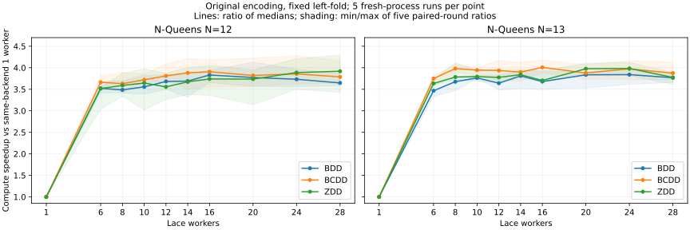

# N=12/13: wider worker scaling

Native C core, original field encoding, fixed left-fold. Each point is the median of five shuffled fresh-process runs; speedup = median(T_native(1)) / median(T_native(p)). The baseline uses the same binary/backend/configuration with one Lace worker. Wall speedup includes initialization and cleanup. These are self-scaling ratios, not ratios against the legacy Java implementation.

| N | Backend | 1 worker s | Best workers | Best compute s [min–max] | Compute speedup | Wall speedup at same workers | Peak RSS median MiB |
|---:|---|---:|---:|---:|---:|---:|---:|
| 12 | BDD | 4.0439 | 16 | 1.0556 [1.0445–1.0838] | 3.831× | 3.708× | 176.7 |
| 12 | BCDD | 4.1211 | 16 | 1.0548 [1.0078–1.1386] | 3.907× | 3.509× | 184.8 |
| 12 | ZDD | 4.1006 | 28 | 1.0465 [1.0355–1.1586] | 3.919× | 3.159× | 185.0 |
| 13 | BDD | 28.0941 | 24 | 7.3154 [7.0309–7.4700] | 3.840× | 3.793× | 856.5 |
| 13 | BCDD | 29.0572 | 16 | 7.2494 [6.9574–7.5315] | 4.008× | 3.911× | 863.6 |
| 13 | ZDD | 28.4184 | 24 | 7.1341 [6.9533–7.6701] | 3.983× | 3.829× | 863.7 |

## N=12: all tested worker counts

| Workers | BDD s / speedup | BCDD s / speedup | ZDD s / speedup |
|---:|---:|---:|---:|
| 1 | 4.0439 / 1.000× | 4.1211 / 1.000× | 4.1006 / 1.000× |
| 6 | 1.1484 / 3.521× | 1.1250 / 3.663× | 1.1661 / 3.517× |
| 8 | 1.1600 / 3.486× | 1.1354 / 3.630× | 1.1425 / 3.589× |
| 10 | 1.1372 / 3.556× | 1.1076 / 3.721× | 1.1250 / 3.645× |
| 12 | 1.0985 / 3.681× | 1.0815 / 3.810× | 1.1534 / 3.555× |
| 14 | 1.0959 / 3.690× | 1.0618 / 3.881× | 1.1164 / 3.673× |
| 16 | 1.0556 / 3.831× | 1.0548 / 3.907× | 1.0965 / 3.740× |
| 20 | 1.0719 / 3.773× | 1.0787 / 3.820× | 1.0976 / 3.736× |
| 24 | 1.0833 / 3.733× | 1.0683 / 3.858× | 1.0547 / 3.888× |
| 28 | 1.1089 / 3.647× | 1.0882 / 3.787× | 1.0465 / 3.919× |

## N=13: all tested worker counts

| Workers | BDD s / speedup | BCDD s / speedup | ZDD s / speedup |
|---:|---:|---:|---:|
| 1 | 28.0941 / 1.000× | 29.0572 / 1.000× | 28.4184 / 1.000× |
| 6 | 8.1072 / 3.465× | 7.7526 / 3.748× | 7.8183 / 3.635× |
| 8 | 7.6419 / 3.676× | 7.2981 / 3.981× | 7.5083 / 3.785× |
| 10 | 7.4646 / 3.764× | 7.3662 / 3.945× | 7.4914 / 3.793× |
| 12 | 7.7151 / 3.641× | 7.3814 / 3.937× | 7.5262 / 3.776× |
| 14 | 7.3700 / 3.812× | 7.4555 / 3.897× | 7.4014 / 3.840× |
| 16 | 7.6364 / 3.679× | 7.2494 / 4.008× | 7.6717 / 3.704× |
| 20 | 7.3243 / 3.836× | 7.4937 / 3.878× | 7.1461 / 3.977× |
| 24 | 7.3154 / 3.840× | 7.3137 / 3.973× | 7.1341 / 3.983× |
| 28 | 7.4563 / 3.768× | 7.4977 / 3.875× | 7.5273 / 3.775× |

## Independently selected end-to-end peaks

| N | Backend | Best workers by wall time | Wall median s | Wall speedup |
|---:|---|---:|---:|---:|
| 12 | BDD | 16 | 1.1124 | 3.708× |
| 12 | BCDD | 16 | 1.1966 | 3.509× |
| 12 | ZDD | 10 | 1.2265 | 3.413× |
| 13 | BDD | 24 | 7.4401 | 3.793× |
| 13 | BCDD | 16 | 7.4621 | 3.911× |
| 13 | ZDD | 20 | 7.3997 | 3.857× |

## Reproduction and interpretation

- 28 guest logical CPUs / 14 guest cores. Affinity order uses one logical CPU per core first, then SMT siblings; workers can migrate within the assigned mask. Guest topology does not guarantee physical host core placement or describe host P/E cores.
- Default task threshold 4, chunk 2, spawn depth 4, combined cache 262144 entries; NDD/batch spawning on, label spawning off. Graph budget 3072 MiB, process RSS ceiling 4096 MiB, timeout 120 s. All configurations share these settings.
- Best means the smallest median among this fixed worker grid. Small differences between nearby configurations can be within run-to-run variability. More workers need not lower execution time. Hyperthreads do not supply independent full cores.
- BITSET is excluded because original N=12/13 field widths exceed its seven-bit limit. Compact encoding is a separate experiment and is not mixed into these ratios.

```sh
python3 native/scripts/benchmark.py --suite wide-scaling --repeats 5 --timeout 120 \
  --rss-mib 4096 --engine-mib 3072 \
  --cores 0,2,4,6,8,10,12,14,16,18,20,22,24,26,1,3,5,7,9,11,13,15,17,19,21,23,25,27 \
  --out results/parallel_ndd_wide_NEW
cp results/parallel_ndd_20261011_wide_scaling/analyze.py results/parallel_ndd_wide_NEW/
python3 results/parallel_ndd_wide_NEW/analyze.py
```

Evidence: [raw samples](samples.csv), [derived scaling](scaling.csv), [selected peaks](best.json), [configuration/provenance](metadata.json), [raw logs](raw_logs.tar.gz), [source snapshot](source_snapshot.tar.gz). Analysis: [analyze.py](analyze.py).

## Scaling curve



[PNG](scaling.png), [plot source](plot.py). Rendered using matplotlib 3.9.4.

## Follow-up correctness and GC validation

All 300 timed samples returned the known solution counts. The follow-up 28-worker test exposed a scheduling-dependent assertion in the old pressure fixture, which required the first OR batch to trigger a GC. A diagnostic run retained all semantic checks and showed ZDD construction had already grown the table to 32768 with 28 workers, whereas it was still 16384 with 6 workers. The former batch fit without another GC. Worker-local 512-bucket allocation regions affect when the table grows.

The revised fixture uses a 256-by-128 Cartesian product of half-word cubes inside one AND batch, verifies 32768 exact singleton results, and forces table growth during active tasks. Its separate test budget is 64 MiB. Release 1/2/4/6/28-worker tests and ASan/UBSan with 28 workers passed. Only the fixture changed after timing; the measured core, driver and JNI hashes remained unchanged.

Evidence: [original assertion failure](validation_28_workers.log), [diagnostic log](pressure_diagnostic.log), [diagnostic source](pressure_diagnostic.c), [revised test source](validation_test_pndd.c), [Release 1/2/4/6](validation_release_ctest.log), [Release 28](validation_28_workers_crossproduct.log), [ASan/UBSan 28](validation_asan_28_workers.log).
